# Glass Home — a calm home screen for Samsung Tizen TVs

A "Liquid Glass"-style launcher web app for Samsung Smart TVs. It shows a big clock, the weather and slowly rotating scenic
photos, with a glass dock of your streaming apps one button-press away. Press **Up** and you get **Discover**: one streaming
service at a time (Netflix, HBO Max, Prime Video, Hulu, Apple TV+, Peacock, Disney+), each with its **Top 3 Shows / Top 3
Movies** ranked by IMDb + Rotten Tomatoes, sliding from service to service like a carousel, plus optional **Resume
Watching** from your Trakt account. Without API keys it falls back to three "Tonight's Picks" from a dated IMDb snapshot.

It is plain HTML/CSS/JavaScript (no framework, no build step besides a small shell script), designed for a 1920×1080 TV.

**New in v4/v5 (all optional):** **Yo-Yo**, a voice assistant you talk to from your iPhone (answers appear on the TV
with posters, IMDb and Rotten Tomatoes scores), an **iPhone remote** web app, **day/night** looks that follow sunrise
and sunset, an **HDMI inputs + Settings** row in the dock and a **picks screensaver**.

**New in v6–v6.2 (all optional, relay + phone):** a ChatGPT-style **Yo-Yo chat** on the phone with saved chats and
multi-turn memory, reliable **hold-to-talk** (the phone records, the relay transcribes), **Wake-on-LAN** power-on,
**"Play X on &lt;service&gt;"**, a small **Yo-Yo reply card** in the corner of the TV and **Show on TV** for long answers.
See [What's new](#whats-new-in-v6-v61-and-v62).

| Ambient (what you see most of the time) | Dock revealed |
|---|---|
| 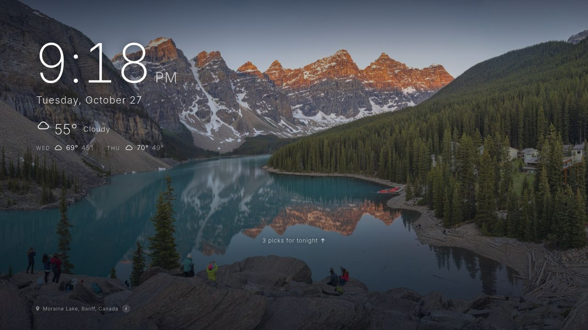 | 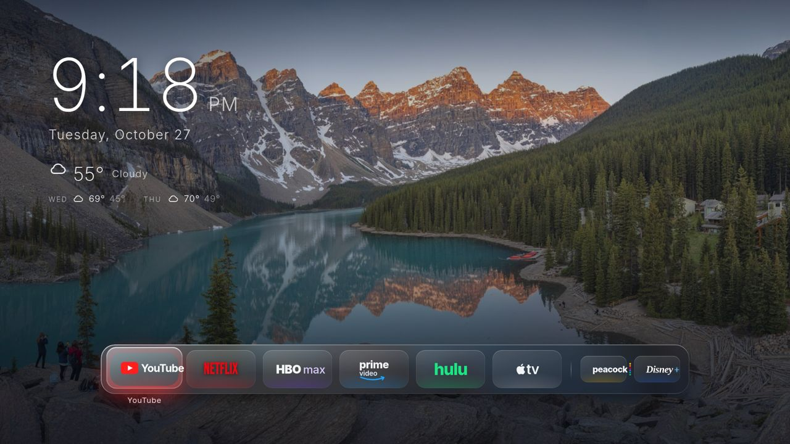 |
| **Discover → Movies** | **Discover → Shows** |
| 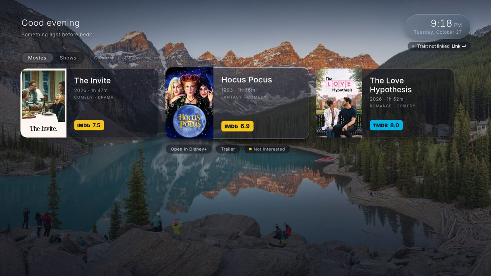 | 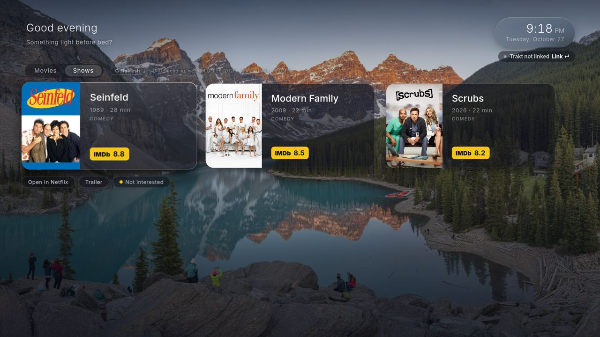 |
| **Discover → Netflix (Movies)** | **Discover → HBO Max (Shows)** |
| 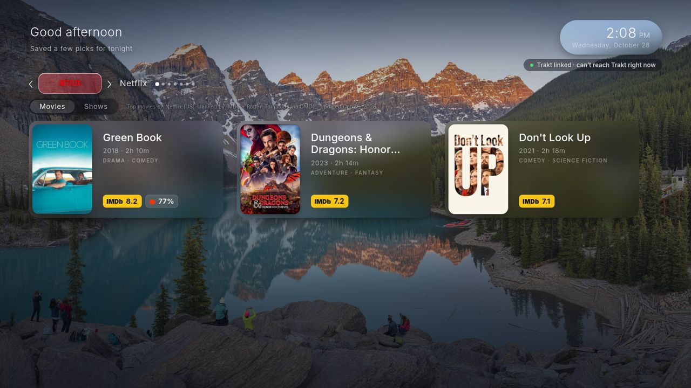 | 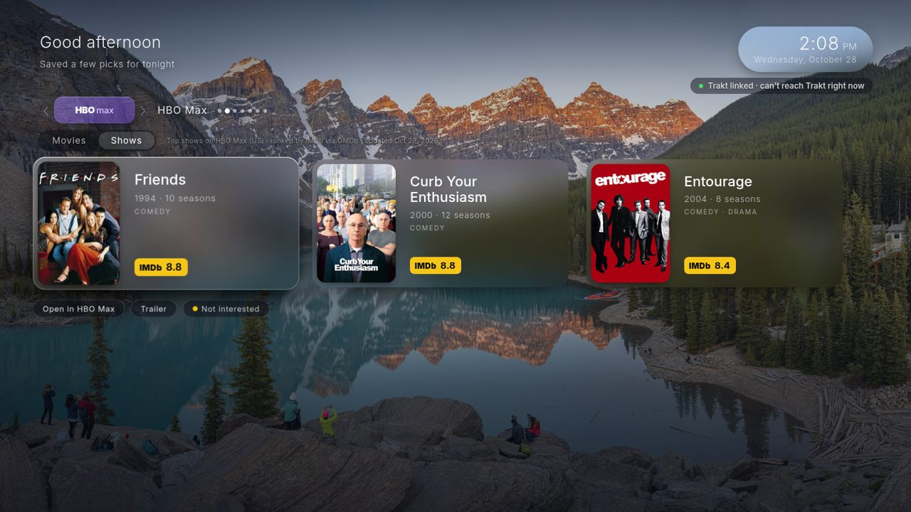 |
| **v5: Day** | **v5: Night (after sunset)** |
|  |  |
| **v5: Inputs + Settings row** (desktop preview with mock inputs) | **v4: Yo-Yo answer on the TV** (recorded demo session) |
| 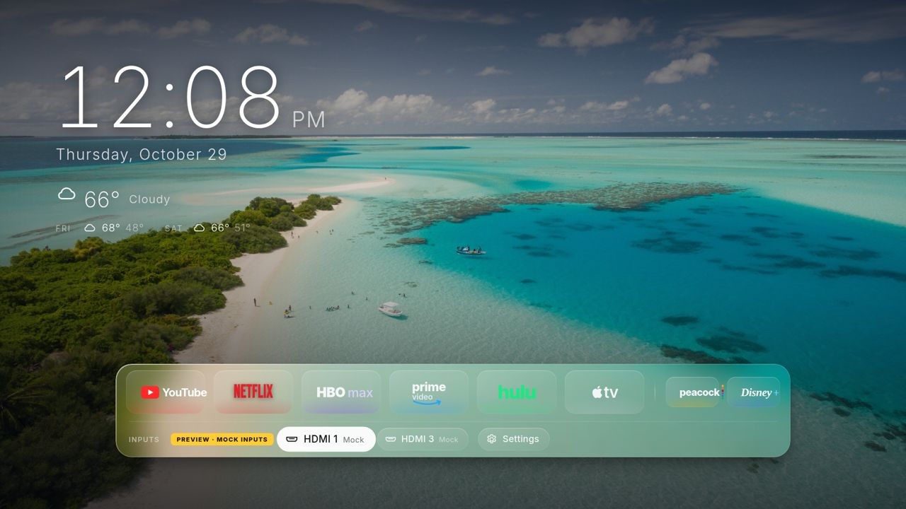 | 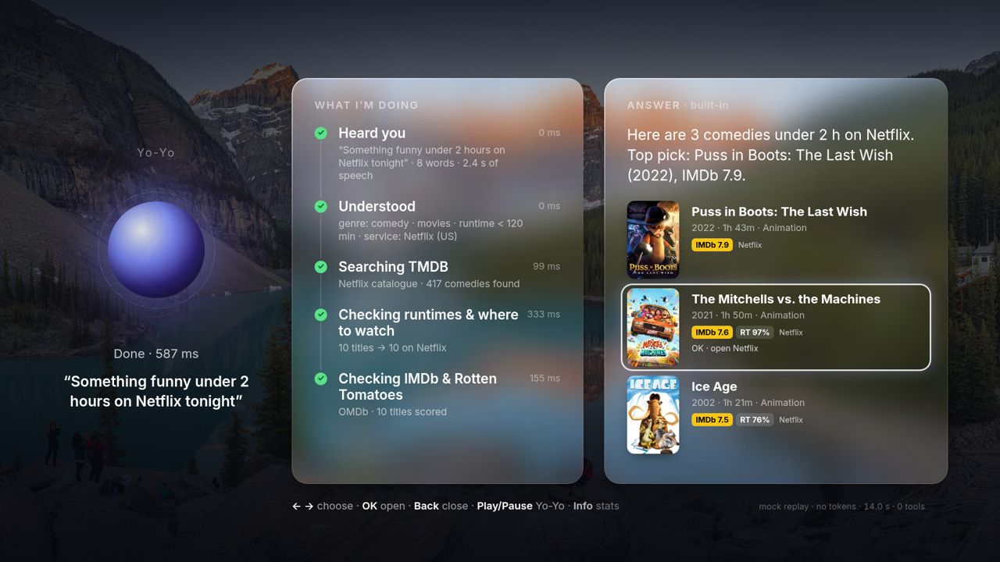 |
| **v6.2: Yo-Yo reply card** (corner of the TV, never takes focus) | **v6.2: Show on TV** (long answer, scrollable panel) |
| 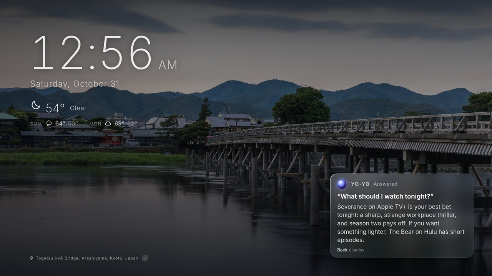 | 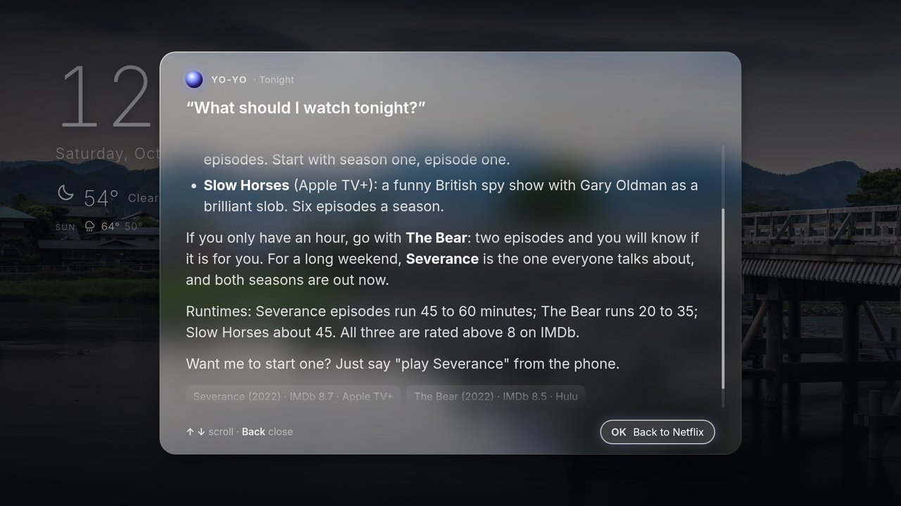 |

| **v6: Yo-Yo chat on the phone** | **v6.2: phone with "Show on TV"** |
|---|---|
| 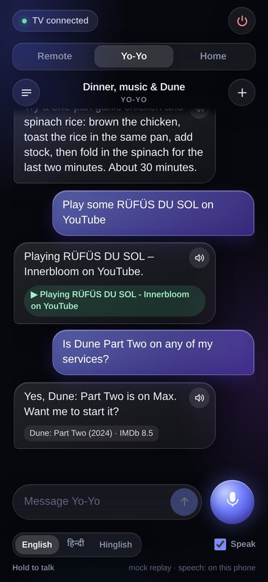 | 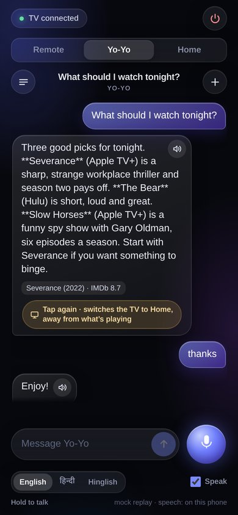 |

*(Screenshots are headless desktop renders at 1920×1080 and iPhone size, with demo data.)*

---

## Contents

0. [What's new in v6, v6.1 and v6.2](#whats-new-in-v6-v61-and-v62) · [v4 and v5](#whats-new-in-v4-and-v5)
1. [Honest limits (read first)](#honest-limits-read-first)
2. [Compatibility](#compatibility)
3. [What you need](#what-you-need)
4. [Install, step by step](#install-step-by-step)
   1. [Enable Developer Mode on the TV](#step-1--enable-developer-mode-on-the-tv)
   2. [Install the Tizen Studio CLI + extensions](#step-2--install-the-tizen-studio-cli--extensions)
   3. [Create a Samsung certificate](#step-3--create-a-samsung-certificate)
   4. [Get free API keys (optional)](#step-4--get-free-api-keys-optional)
   5. [Configure](#step-5--configure)
   6. [Build](#step-6--build)
   7. [Package, install and run](#step-7--package-install-and-run)
   8. [Make it open when the TV turns on](#step-8--make-it-open-when-the-tv-turns-on)
5. [Remote controls](#remote-controls)
   - [Day/night, inputs row, screensaver (v5)](#daynight-inputs-row-screensaver-v5)
   - [Yo-Yo voice assistant + iPhone remote (v4, optional)](#yo-yo-voice-assistant--iphone-remote-v4-optional)
   - [Yo-Yo chat, hold-to-talk and languages (v6)](#yo-yo-chat-hold-to-talk-and-languages-v6)
   - [Wake-on-LAN (v6)](#wake-on-lan-v6)
   - [Play X on &lt;service&gt; (v6)](#play-x-on-service-v6)
   - [Yo-Yo reply card and Show on TV (v6.2)](#yo-yo-reply-card-and-show-on-tv-v62)
   - [Relay endpoints](#relay-endpoints)
6. [Trying it on your computer first](#trying-it-on-your-computer-first) (and [Tests](#tests))
7. [Troubleshooting](#troubleshooting)
8. [Uninstall / undo everything](#uninstall--undo-everything)
9. [Project layout](#project-layout)
10. [Changelog](#changelog)
11. [Credits & licenses](#credits--licenses)

---

## What's new in v6, v6.1 and v6.2

**v6.2: Yo-Yo on the TV without getting in the way**
- **Reply card:** when you ask Yo-Yo from the phone, a small glass card in the bottom-right corner of the TV shows the
  question, the answer and a state orb. It appears **only while the launcher is on screen**, **never takes focus** (the
  remote keeps driving Home) and **fades by itself**. Turn it off with `voice: { …, card: false }` in `js/config.js` or
  `?vcard=0` in the URL (then phone questions open the full overlay as before).
- **Show on TV:** long answers (250+ characters) get a **Show on TV** button on the phone (two taps: the first warns that
  the TV switches to Home). The relay brings the launcher forward (`POST /tv/show`) and the TV shows a scrollable panel;
  **OK** = "Back to &lt;app&gt;" (`POST /tv/back`) returns to the app you were watching.
- **Limit:** a Tizen web app can't draw on top of other apps, so nothing appears over Netflix, YouTube and so on.

**v6.1: Play fixes**
- Netflix: when it starts cold on "Who's watching?", the relay presses OK on the highlighted profile and re-sends the
  title link (best effort). App launches use **numeric Samsung app ids** over the TV's REST API with an 8 s timeout.
- YouTube is honest: it **opens the YouTube app**; to play a specific video, cast from the YouTube app on your phone.

**v6: Chat, hold-to-talk, Wake-on-LAN, Play X on &lt;service&gt;** (relay + phone; the TV app's overlay is unchanged)
- **Yo-Yo chat:** a ChatGPT-style chat tab on the phone (bubbles, text box, big mic). Every chat is **saved on the relay
  computer** in `relay/data/chats/` (git-ignored, owner-only permissions); ☰ lists, renames and deletes chats, **+** starts
  a new one. Multi-turn memory: a rolling summary plus the last 8 turns go to the model.
- **Hold-to-talk that works every time:** iPhone Safari's `webkitSpeechRecognition` tended to abort after the first press in
  a Home Screen web app, so the phone now records with `MediaRecorder` and the relay transcribes it (`POST /stt`) with
  **Gemini** (default, same free key) or optional **local whisper.cpp** (`relay/tools/install-whisper.sh`).
- **English / हिन्दी / Hinglish** toggle (recognition, reply language and voice), **spoken replies** in the iPhone's own
  voice, and a **stats line** (time, model, tokens) under each answer.
- **Wake-on-LAN:** the phone's power button (and "play …" while the TV is off) wakes the TV, then the launcher opens.
- **"Play X on &lt;service&gt;":** "play Breaking Bad on Netflix" plays it (deep link via DIAL); other services open the app.

## What's new in v4 and v5

**v5: Day/night, inputs, screensaver**
- **Day/night:** day runs from today's sunrise to sunset (taken from the same Open-Meteo weather request, no extra call;
  06:30 / 18:30 when there's no forecast). At night a cool, dimmer tint fades over the wallpaper and glass, the clock text
  gets softer, and wallpapers tagged for night are preferred. `?tod=day|night` forces it in a browser.
- **HDMI inputs + TV Settings row:** press **Down** from the apps. Ports come only from what the TV reports
  (`tizen.systeminfo` `VIDEOSOURCE`), labelled "HDMI 1", "HDMI 2"… (plus a device name only if the TV supplies one; web
  apps get no CEC names). **OK** switches the input; the Settings chip opens Samsung's settings. Needs the new
  `http://tizen.org/privilege/tv.window` privilege (already in `config.xml`). If the TV reports nothing, the row stays hidden.
- **Picks screensaver:** after 5 minutes without a key on the Ambient home, full-screen backdrops of the current picks
  drift slowly with a big glass clock and the title's IMDb/RT badges. **OK** opens the title's app; any other key just
  closes it. It never starts from snapshot/mock data or when there's no real backdrop.

**v4: Yo-Yo voice assistant and iPhone remote** (needs a small Node.js relay on a Mac/PC at home; everything else works without it)
- **Yo-Yo on the TV:** an orb plus a live timeline of what it's doing ("Heard you → Understood → Searching TMDB →
  Checking IMDb & Rotten Tomatoes"), then an answer panel with posters, IMDb and RT badges; ◀ ▶ pick a title, **OK**
  opens its app. **Play/Pause** on the TV remote opens Yo-Yo; **Info** shows a small stats card.
- **iPhone page** (add it to your Home Screen): **Remote** tab (D-pad or touchpad, Back/Home/Play, volume, mute, power with
  Wake-on-LAN, app shortcuts), **Yo-Yo** tab (hold to talk, spoken replies in the iPhone's own voice, English / Hindi /
  Hinglish, **New chat**, 30-minute memory), **Home** tab (placeholder).
- **Brains, cheapest first:** a free-tier cloud LLM through an OpenAI-compatible API (Gemini by default, Groq preset,
  or any provider), then **Ollama** on your Mac if it's running, then a built-in rule-based parser that needs no AI at all.
  Tools: TMDB, OMDb, Open-Meteo and launcher actions. Daily caps and a billing hard-stop keep it at zero cost.
- **Trakt "Up next":** Resume Watching now also shows the next unwatched episode of shows you started.
- **Auto-open:** the relay can open the launcher automatically every time the TV turns on (no pairing needed).

## Honest limits (read first)

- **It sits on top of Samsung's home screen; it does not replace it.** Samsung doesn't let third-party apps become the
  system launcher. The **Home** button on the remote will always open Samsung's own home bar. Step 8 shows how to make
  this app come back automatically when the TV turns on.
- **No cross-app watch history.** Netflix, Prime, etc. don't share what you're watching with other apps. "Resume Watching"
  only works if you use [Trakt](https://trakt.tv) (and something that scrobbles to Trakt); without it that row simply hides.
- **"Open in &lt;App&gt;", not "Play".** Streaming apps don't offer a public way to jump straight to a title, so a pick
  opens the right app and you find the title there. Only YouTube trailers open directly. The one exception is Yo-Yo's
  "play X on Netflix" (v6), which uses Netflix's DIAL deep link; it's best effort (it needs Wikidata to know the title's
  Netflix id, and the profile picker step may need you).
- **YouTube can't be told what to play from outside.** "Play X on YouTube" **opens the YouTube app**; the TV refuses DIAL
  video links from a third party and deep links only open YouTube's home. To play a specific video, cast it from the
  YouTube app on your phone. (An experimental key-press search, `YT_MODE=search`, is off by default and unreliable.)
- **Nothing can appear on top of other apps.** A Tizen web app can't overlay Netflix, YouTube or live TV. The v6.2 reply
  card only shows while Glass Home is on screen; **Show on TV** brings Glass Home forward and offers "Back to &lt;app&gt;".
- **Wake-on-LAN needs a TV setting.** Turn on **Power On with Mobile**; Wi-Fi TVs may not wake after a long deep standby.
- **Developer-mode apps aren't permanent.** Apps sideloaded in Developer Mode can disappear or stop launching after
  firmware updates, factory resets, or when the developer certificate expires. You may need to rebuild, re-sign and
  reinstall from time to time (it takes a minute once everything is set up).
- **Your API keys end up inside your build.** `tools/make-dist.sh` writes your keys (and Trakt tokens) into
  `dist/js/config.js`, which is packaged into the `.wgt`. **Never publish or share your `dist/` folder or `.wgt` file.**
  The repo itself keeps every key field empty, and `.gitignore` excludes `dist/`, `.secrets/` and `*.wgt`.
- Tonight's Picks are deliberately "light": comedy-led, family/romance OK, no horror/thriller/crime/war leads.
  Change the filters in `js/discover.js` if you want something else.
- Weather is in °F (Open-Meteo). App IDs and streaming-service matching are tuned for the **US** region.
- **Yo-Yo and the iPhone remote need a computer that stays on** (the relay). It has no authentication: anyone on your
  Wi-Fi can send it requests, including TV key presses. Keep it on your home network and **never port-forward it**.
- **The iPhone mic needs HTTPS.** Safari only allows the microphone on a secure page, so voice from the phone needs
  the optional local certificate in [HTTPS for the iPhone mic](#https-for-the-iphone-mic-optional). Typing questions works without it.
- **Saved chats live on the relay computer** (`relay/data/chats/`, plain JSON, owner-only permissions). With the Gemini
  brain or Gemini speech-to-text, your questions and recordings are sent to Google; use Ollama + whisper.cpp to keep
  everything local.
- **Free AI tiers change.** Provider limits, model names and data-use terms are set by the provider; on Google's free
  tier your prompts may be used to improve their products. The relay falls back to its built-in parser when the AI is
  unavailable or over your daily cap.
- **Input names:** web apps can't read HDMI-CEC device names, so inputs are usually just "HDMI n".

## Compatibility

| | |
|---|---|
| Suggested | Samsung Smart TVs with **Tizen 6.0 or newer** (roughly **2021 models and later**). `config.xml` sets `required_version="6.0"`. |
| Tested on | **Samsung QN90A (2021, Tizen 6.0)**, US region |
| Older TVs | Might work, untested. The code avoids newer JS/CSS (Tizen 6.0 is a Chromium-76-class browser). |
| Not supported | Non-Samsung TVs, Samsung TVs not running Tizen. |

## What you need

- A Samsung Tizen TV (see above) connected to your home network.
- A **Mac or Windows PC on the same Wi-Fi/network** as the TV. (Linux works too; commands are the same as Mac.)
- A free **Samsung account** (used to create the signing certificate).
- About 30–45 minutes the first time.
- Optional, all free: a TMDB account, an OMDb key, a Trakt account.
- Optional for Yo-Yo / iPhone remote: a Mac (or any always-on computer) with **Node.js 14+**, an iPhone with Safari, and
  optionally a free Gemini or Groq API key.

---

## Install, step by step

> Throughout this guide, replace `<TV_IP>` with your TV's IP address and `<TARGET>` with the device name that
> `sdb devices` prints (it usually looks like `<TV_IP>:26101` or your model number, e.g. `QN75QN90AAFXZA`).

### Step 1 — Enable Developer Mode on the TV

1. Find your **computer's** IP address:
   - Mac: System Settings → Wi-Fi → Details → IP address (or run `ipconfig getifaddr en0`).
   - Windows: run `ipconfig` in Command Prompt and look for "IPv4 Address".
2. On the TV, open the **Apps** panel (Home button → Apps).
3. With the Apps screen open, type **`1` `2` `3` `4` `5`** on the remote (on remotes without number keys use the
   on-screen number pad: press the 123/color button). A *Developer Mode* dialog appears.
4. Switch **Developer mode** to **On**, enter your computer's IP in **Host PC IP**, and press **OK**.
5. **Restart the TV**: hold the power button on the remote until the TV turns off and back on (a normal off/on is not
   enough). Afterwards the Apps screen shows "Developer Mode" at the top.
6. Find the **TV's IP address**: Settings → General → Network → Network Status → IP Settings.

### Step 2 — Install the Tizen Studio CLI + extensions

1. Download **Tizen Studio "CLI" installer** (the small one, not the full IDE) from
   <https://developer.tizen.org/development/tizen-studio/download> (scroll to *Installing Tizen Studio CLI*).
   You also need Java (a JDK/JRE 8 or newer) for the package manager.
2. Install it:

   **Mac**
   ```sh
   cd ~/Downloads
   chmod +x web-cli_Tizen_Studio_*_macos-64.bin
   ./web-cli_Tizen_Studio_*_macos-64.bin --accept-license ~/tizen-studio
   echo 'export PATH="$HOME/tizen-studio/tools:$HOME/tizen-studio/tools/ide/bin:$PATH"' >> ~/.zshrc
   source ~/.zshrc
   ```

   **Windows** (Command Prompt): run `web-cli_Tizen_Studio_<version>_windows-64.exe`, install to `C:\tizen-studio`, then
   add the tools to your PATH:
   ```bat
   setx PATH "%PATH%;C:\tizen-studio\tools;C:\tizen-studio\tools\ide\bin"
   ```
   Close and reopen Command Prompt afterwards.

3. Install the TV extensions and the certificate tools with the Package Manager:

   **Mac**
   ```sh
   ~/tizen-studio/package-manager/package-manager-cli.bin install --accept-license \
     cert-add-on TV-SAMSUNG-Extension-Tools Certificate-Manager
   ```
   **Windows**
   ```bat
   C:\tizen-studio\package-manager\package-manager-cli.exe install --accept-license cert-add-on TV-SAMSUNG-Extension-Tools Certificate-Manager
   ```
   - `cert-add-on` = **Samsung Certificate Extension** (lets you create *Samsung*-type certificates).
   - `TV-SAMSUNG-Extension-Tools` = Samsung TV tools/profile.
   - `Certificate-Manager` = the **Certificate Manager** app.

   Package names occasionally change between Tizen Studio versions. If one is "not found", list them with
   `package-manager-cli.bin show-pkgs` (Windows: `package-manager-cli.exe show-pkgs`), or open the graphical Package
   Manager (`~/tizen-studio/package-manager/package-manager.bin` / `C:\tizen-studio\package-manager\package-manager.exe`),
   go to **Extension SDK** and install **TV Extensions** and **Samsung Certificate Extension**.

4. Check it works:
   ```sh
   tizen version
   sdb version
   ```

### Step 3 — Create a Samsung certificate

The TV only installs apps signed with a Samsung certificate that names your TV's **DUID** (a unique device ID).

1. Connect to the TV once (so the Certificate Manager can read the DUID):
   ```sh
   sdb connect <TV_IP>
   sdb devices          # should list your TV; note the name in the first column = <TARGET>
   ```
2. Open **Certificate Manager**:
   - Mac: `~/tizen-studio/tools/certificate-manager/` → open the Certificate Manager app.
   - Windows: `C:\tizen-studio\tools\certificate-manager\certificate-manager.exe`.
3. Click **+** (create a certificate profile) → choose **Samsung** → device type **TV** → give the profile a name
   (any name, e.g. `MyTV`; this is your `<CERT_PROFILE>`).
4. **Author certificate**: *Create a new author certificate*, fill in a name and a password, sign in with your Samsung
   account when asked.
5. **Distributor certificate**: keep the default privilege (**Public**). In the **DUID** list your TV should appear
   automatically. If it doesn't, get the DUID yourself and paste it in:
   ```sh
   sdb shell 0 getduid
   ```
6. Finish. Make sure the new profile is the **active** one (check mark) in Certificate Manager.

> The certificate is tied to **your** TV's DUID. If you get a different TV, add its DUID to the profile and re-sign.

### Step 4 — Get free API keys (optional)

Everything is optional. **With no keys** the launcher still works: Tonight's Picks come from the bundled, dated
snapshot of IMDb's public "Most Popular" charts (`data/weekly.embed.js`) and Resume Watching is hidden.

| Service | What it adds | Where | Env var |
|---|---|---|---|
| **TMDB** | Live trending picks, where-to-watch (US), runtimes, trailers | <https://www.themoviedb.org/settings/api> (free account → request an API key; "Developer", personal use) | `TMDB_API_KEY` (v3 key) **or** `TMDB_READ_TOKEN` (v4 read token) |
| **OMDb** | IMDb ratings on the picks (free tier: 1,000 requests/day) | <https://www.omdbapi.com/apikey.aspx> (choose FREE, confirm the email) | `OMDB_API_KEY` |
| **Trakt** | Resume Watching, hide already-watched titles, recommendations | <https://trakt.tv/oauth/applications> → **New Application** | `TRAKT_CLIENT_ID` (and optionally `TRAKT_CLIENT_SECRET`) |

**Trakt setup (optional):**
1. Create the app with **Redirect URI** `http://localhost` and tick the **PKCE** option if offered (no secret needed).
2. Copy the **Client ID**.
3. Link your account once from your computer (needs only `sh`, `curl`, `openssl`; on Windows use Git Bash or WSL):
   ```sh
   TRAKT_CLIENT_ID=your_client_id sh tools/trakt-link.sh
   ```
   It prints (and on a Mac opens) a Trakt sign-in URL. Approve; the browser then lands on
   `http://localhost/?code=...` and shows an error page — **that's expected**. Copy the whole address-bar URL and paste it
   into the script. Tokens are saved to `.secrets/trakt-tokens.json` (never printed, git-ignored) and baked into your
   build by step 6. The TV refreshes them on its own afterwards.

   (There is also an on-TV "Link" option using Trakt's device code flow, but it needs a client secret; the script above
   is the reliable path.)

### Step 5 — Configure

All settings live in two files. Edit them before building.

**a) Your apps — `js/apps.js` and the dock list in `js/config.js`**

`js/apps.js` already knows YouTube, Netflix, HBO Max, Prime Video, Hulu, Apple TV, Peacock and Disney+.
Choose which appear (and in what order) in `js/config.js`:
```js
dock: {
  main:  ['youtube', 'netflix', 'hbomax', 'prime', 'hulu', 'appletv'],   // large icons
  extra: ['peacock', 'disney']                                           // smaller icons after a divider
},
```
You don't need to have every app installed; the launcher tries several known IDs and also matches installed apps by name.

*Adding an app or fixing an ID.* Launching needs the app's **Tizen app ID** (looks like `9Ur5IzDKqV.TizenYouTube`).
Ways to find the IDs on your TV:
- Set `debug: true` in `js/config.js`, build and install, then open the Web Inspector
  (`tizen run -p GlassHome1.launcher -t <TARGET>` while Developer Mode is on, or use `sdb shell 0 debug GlassHome1.launcher`
  and open the printed port in Chrome). The console logs an `installed map` of every app name → ID.
- Or try `sdb shell 0 vd_applist` (works on many Samsung firmwares) and look for the app's name.
- Community lists: [homebridge-samsung-tizen app IDs](https://github.com/tavicu/homebridge-samsung-tizen) and
  [samsung-tv-ws-api APPLICATIONS.md](https://github.com/xchwarze/samsung-tv-ws-api).

Then either put the ID first in that app's `tizenIds` in `js/apps.js`, or override it without touching apps.js:
```js
appIdOverrides: { peacock: ['gzcc4LRFBF.Peacock'] },
```
To add a new app, copy one entry in `js/apps.js` (give it a key, `name`, `color`, `tizenIds`, `names`, `match`) and add the
key to `dock.main` or `dock.extra`. Icons/logos are in `js/logos.js`.

**b) Weather location — `js/config.js` → `weather`**
```js
weather: {
  enabled: true,
  lat: 37.3382, lon: -121.8863,   // example: San Jose, CA  ← CHANGE to your location
  timezone: 'America/Los_Angeles', // ← your IANA time zone, e.g. 'America/New_York', 'Europe/London'
  ...
}
```
Look up your coordinates on any map (right-click → coordinates). Weather comes from Open-Meteo (free, no key).
Set `enabled: false` to hide it.

**c) Greeting / household name — `js/config.js` → `ui`**
```js
ui: { greeting: true, userName: 'Smith family', clock24h: false, ... }
```
`userName: ''` shows just "Good evening". `greeting: false` hides it.

**d) Other useful settings** (all in `js/config.js`, each commented): `discover.region` (TMDB watch region, default `US`),
`wallpaper.intervalSec` (default 50 s), `idle.minutes` (fade to wallpaper-only after 10 min), `idle.keepScreenOn`,
`back.mode` (`'double'` = press Back twice on the first tile to exit, `'never'`).

**e) v5 features — `dayNight`, `inputs`, `screensaver`** are on by default; set `enabled: false` in any of them to
turn it off (`screensaver.minutes` sets the delay, `dayNight.fallbackSunrise/fallbackSunset` the times used without a forecast).

**f) Voice / iPhone remote — `js/config.js` → `voice`.** Leave `relay: ''` (the default) and the voice feature stays
completely hidden. To use it, set up the relay first ([below](#yo-yo-voice-assistant--iphone-remote-v4-optional)), then:
```js
voice: { enabled: true, relay: 'http://YOUR-MAC-IP:8787' },   // your Mac's LAN IP, e.g. 'http://192.168.1.20:8787'
```

**g) Optional: change the app's ID/name.** `config.xml` uses package `GlassHome1` / app ID `GlassHome1.launcher` and the
name **Home**. If you change the ID, the package part must be exactly 10 letters/digits, and use your new ID in the
commands below.

### Step 6 — Build

`tools/make-dist.sh` copies only the runtime files into `dist/`, inlines the CSS, and injects your keys from environment
variables into `dist/js/config.js` (only there — the repo copy stays empty). It prints which keys it used, never their values.

**Mac / Linux**
```sh
cd path/to/this/repo
export TMDB_API_KEY=xxxxxxxx      # or: export TMDB_READ_TOKEN=xxxxxxxx
export OMDB_API_KEY=xxxxxxxx
export TRAKT_CLIENT_ID=xxxxxxxx   # optional; tokens from tools/trakt-link.sh are picked up automatically
sh tools/make-dist.sh
```
**Windows**: run the same in **Git Bash** (comes with [Git for Windows](https://git-scm.com/download/win)) or WSL; it needs
`sh` and `python3`.
```sh
TMDB_API_KEY=xxxx OMDB_API_KEY=xxxx sh tools/make-dist.sh
```
No keys? Just run `sh tools/make-dist.sh` — it builds in offline snapshot mode.

Supported variables: `TMDB_API_KEY`, `TMDB_READ_TOKEN`, `OMDB_API_KEY`, `TRAKT_CLIENT_ID`, `TRAKT_CLIENT_SECRET`.

### Step 7 — Package, install and run

```sh
# 1. Sign and package dist/ into a .wgt with your certificate profile from step 3
tizen package -t wgt -s <CERT_PROFILE> -- dist
ls dist/*.wgt            # the file is named after <name> in config.xml: dist/Home.wgt

# 2. Connect and install in ONE command (the TV tends to drop idle sdb connections)
sdb connect <TV_IP> && tizen install -n Home.wgt -t <TARGET> -- dist

# 3. Start it
tizen run -p GlassHome1.launcher -t <TARGET>
```
On Windows Command Prompt the same commands work (`&&` is supported in cmd).

Tips:
- `<TARGET>` is the name shown by `sdb devices` (first column).
- If `sdb` acts up ("target not found", "device offline"), reset it and reconnect:
  ```sh
  sdb kill-server
  sdb connect <TV_IP>
  sdb devices
  ```
- After changing settings, repeat steps 6 and 7. Re-installing replaces the old version.

The app also appears in the TV's **Apps** list as **Home** (you can add it to the Home bar from there).

### Step 8 — Make it open when the TV turns on

Samsung TVs can reopen the last app you used on power-on:

**Settings → General → Start Screen Option** (on some models **Smart Features**) → **Autorun Last App: On**.

Leave the launcher in front when you turn the TV off, and it comes back next time. (The Home button will still open
Samsung's home bar — see [Honest limits](#honest-limits-read-first).)

---

## Remote controls

| Button | What it does |
|---|---|
| Any arrow / **Enter** (in Ambient) | Reveal the dock (that first press does nothing else) |
| **Left / Right** | Move between apps, cards, tabs |
| **Enter** | Launch the focused app / run the focused action |
| **Up** (from the dock) — "Up for picks" | Open **Discover** (Resume Watching first if you have any, otherwise the middle pick; Movies \| Shows tabs) |
| **Up / Down** (in Discover) | Move between Resume Watching, the service header, Movies \| Shows tabs, picks and the card actions (*Open in &lt;App&gt;*, *Trailer*, *Not interested*) |
| **Left / Right** on the service header | Slide to the previous / next streaming service (also: Right past the last card, Left past the first) |
| **Channel Up / Down** (in Discover) | Next / previous streaming service from anywhere in Discover |
| **Down** from a pick | Its actions; **Down** again (from the actions) returns to the dock |
| **Back** | Step back: hide the photo credit → leave a card's actions → leave Discover → hide the dock → jump to the first tile. From there, Back **twice within 2 s** exits (`back.mode`; `'never'` disables exiting) |
| **Red** | Cycle the glass look: baked → live blur → solid |
| **Green** | Show/hide an FPS counter |
| **Yellow** | On a focused pick: *Not interested* (never shows again). Elsewhere: show the wallpaper photo credit |
| **Blue** | Next wallpaper |
| **Down** (from the apps) | Inputs + Settings row (v5), when the TV reports inputs |
| **Play/Pause** | Open Yo-Yo (v4, when the relay is set and reachable) |
| **Info** (in Yo-Yo) | Show/hide the stats card (Yellow works too) |
| Any key while idle | Wakes the screen (that key does nothing else) |

The dock hides again after 8 s without a key (`dockAutoHideSec`). After 10 min idle everything fades out except the
wallpaper, which slowly dims (`idle` settings).

## Day/night, inputs row, screensaver (v5)

- **Day/night** (`js/daynight.js`): sunrise/sunset come from the weather request (`daily=sunrise,sunset` added to the same
  call). Night adds `body.night`: a tint layer crossfaded over `fadeMs` (opacity only, cheap on the TV GPU). Wallpapers
  carry `timeOfDay` tags; the rotator prefers photos that fit the current time. Re-checked every `checkMin` minutes, on
  weather refresh and when the launcher comes back to the front.
- **Inputs** (`js/inputs.js`): ports from `tizen.systeminfo.getPropertyValue('VIDEOSOURCE')` (connected ones when the TV
  reports it; live updates). OK calls `tizen.tvwindow.setSource(...)` and then shows the TV viewer
  (`org.tizen.tv-viewer`; if that fails the launcher hides itself). Settings uses the
  `http://tizen.org/appcontrol/operation/setting` app control, then `settingsAppIds`. Everything is feature-detected; no
  data → no row. In a desktop browser the row is empty; `?inputs=mock` shows a clearly labelled preview row.
- **Screensaver** (`js/saver.js`): only on the Ambient home (not with Discover, the dock, a toast, Yo-Yo or a launch in
  progress). Backdrops are TMDB `original` (or `w1280`) images; transform-only Ken Burns drift and opacity crossfades.
  The wallpaper rotation pauses while it runs. `?idlescale=` speeds up idle timers for tests.
- Test: `node tools/test-v5.js` (offline; needs playwright-core + Chrome, see [Trying it on your computer first](#trying-it-on-your-computer-first)).

## Yo-Yo voice assistant + iPhone remote (v4, optional)

The TV app can't use a microphone, so the iPhone is the mic, and a tiny **zero-dependency Node.js relay** on a computer at
home does the thinking and streams each step to the TV. Full reference (every endpoint, env var and test):
[`relay/README.md`](relay/README.md).

```
iPhone (Safari page) ──POST /ask──▶ relay on your Mac ──SSE /events──▶ TV launcher (Yo-Yo overlay)
                                     │  brain: free-tier LLM → Ollama → built-in parser
                                     │  tools: TMDB · OMDb · Open-Meteo · launcher actions
                                     └─ Samsung local remote API (keys, app launch, Wake-on-LAN) ──▶ TV
```

### Step A — Run the relay on your Mac

1. Install Node.js 14 or newer (`node -v`; get it from <https://nodejs.org> or `brew install node`).
2. Give the **Mac** and the **TV** fixed addresses: in your router's admin page add a **DHCP reservation** for each.
   The examples below use `YOUR-MAC-IP` and `YOUR-TV-IP` (e.g. `192.168.1.20` and `192.168.1.50`).
3. Put your settings in `relay/.env` (git-ignored; keys are optional; never commit them) and start the relay:
   ```sh
   cd relay
   cp .env.example .env && chmod 600 .env     # edit it: TV_IP, TV_MAC, GEMINI_API_KEY, TMDB_API_KEY, OMDB_API_KEY, …
   set -a && . ./.env && set +a && node server.js
   ```
   The variables you'll most likely set (placeholders only; see [`relay/.env.example`](relay/.env.example) and
   [`relay/README.md`](relay/README.md) for all of them):

   | Variable | Example | What for |
   |---|---|---|
   | `TV_IP` | `192.168.1.50` | Remote tab, app launches, auto-open, Show on TV |
   | `TV_MAC` | `aa:bb:cc:dd:ee:ff` | Wake-on-LAN (or leave empty: the relay learns it once the TV is seen on) |
   | `GEMINI_API_KEY` | *your key* | Brain and speech-to-text (free tier) |
   | `TMDB_API_KEY`, `OMDB_API_KEY` | *your keys* | Titles, posters, providers, IMDb / Rotten Tomatoes scores |
   | `BRAIN_PRESET` | `gemini` | `gemini`, `groq` or `ollama` |
   | `WEATHER_LAT`, `WEATHER_LON`, `WEATHER_PLACE`, `HOME_TZ` | San Jose / `America/Los_Angeles` | Weather answers and "today" |
   | `STT` | `auto` | `auto` (whisper.cpp if installed, else Gemini), `whisper`, `gemini`, `off` |
   | `YT_MODE` | `dial` | `dial` (default: opens YouTube) or `search` (experimental) |
   The startup output lists the brain chain, which keys are present (never their values) and the phone URL.
   macOS may ask to allow incoming connections for `node`: click **Allow**.
   - No AI key? `BRAIN=free node server.js` uses only the built-in parser (TMDB/OMDb/weather still work).
   - Just want to see it? `MOCK=1 node server.js` replays a recorded demo session with no keys or network.
4. Set `voice.relay` in `js/config.js` to `http://YOUR-MAC-IP:8787`, rebuild and reinstall the TV app (steps 6–7).
5. Set your location for weather answers: `WEATHER_LAT`, `WEATHER_LON`, `WEATHER_PLACE` and `HOME_TZ` (the default is an
   example location, San Jose, CA).

### Step B — Choose a brain (all free)

| `BRAIN_PRESET` | What | Key |
|---|---|---|
| `gemini` (default) | Google Gemini free tier via its OpenAI-compatible API | `GEMINI_API_KEY` from <https://aistudio.google.com> → Get API key (no card) |
| `groq` | Groq free tier (`openai/gpt-oss-120b`) | `GROQ_API_KEY` from <https://console.groq.com> |
| `ollama` | Local model on your Mac (`ollama pull qwen3:8b`, or `qwen3:4b` on 8 GB Macs) | none |
| — | Any OpenAI-compatible provider | `LLM_BASE_URL`, `LLM_API_KEY`, `LLM_MODEL` |

The relay tries the primary model, then Ollama (only if it's running and the model is pulled), then the built-in parser.
`BRAIN=free` skips AI entirely.

**Zero-cost guard:** remote AI calls are capped per Pacific day by `LLM_MAX_REQUESTS_PER_DAY` (default 200) and
`LLM_MAX_TOKENS_PER_DAY` (default 200000). Over the cap it uses Ollama or the parser and the TV says "daily AI limit
reached". If a provider ever mentions billing/payment (or returns HTTP 402), remote calls stop until you delete
`relay/logs/llm-budget.json`. Use a key from a project **without billing enabled** so it can't be charged at all.

**Stats & evals:** every request is timed (`GET /stats`, `GET /status`; a faint stats line under the TV answer, **Info**
for details; **Stats** on the phone). `node relay/evals/run.js [--brain gemini|groq|ollama|free]` runs 20 test questions
and writes a report to `relay/evals/reports/` (git-ignored).

### Step C — The iPhone page

1. On the iPhone (same Wi-Fi), open `http://YOUR-MAC-IP:8787/` in Safari → Share → **Add to Home Screen**.
2. **Yo-Yo tab:** a chat (see [v6](#yo-yo-chat-hold-to-talk-and-languages-v6)). Press and hold the mic, talk, release
   to send (slide off to cancel), or type. Answers are spoken in the iPhone's own voice (tap the speaker to repeat).
   **English / हिन्दी / Hinglish** switches recognition, reply language and voice. ☰ lists saved chats, **+** starts a new one.
   Better voices: Settings › Accessibility › Spoken Content › Voices → download an *Enhanced* voice.
3. **Remote tab:** D-pad or touchpad, Back, Home, Play/Pause, volume, mute, power and app shortcuts (from your dock).
4. **Home tab:** placeholder for future smart-home controls.

The microphone needs the HTTPS page from the next section; typing works on plain HTTP.

### HTTPS for the iPhone mic (optional)

Safari only allows the microphone (recording and speech recognition) on a secure page. The relay serves HTTPS on port
`8788` (`HTTPS_PORT`) when `relay/certs/server.key` and `relay/certs/server.crt` exist (`relay/certs/` is git-ignored).
**Shortcut (v6):** `bash relay/tools/make-certs.sh YOUR-MAC-IP` does all of the following for you. Or by hand: make your
own tiny local CA that is **name-constrained** so it can only ever vouch for your Mac's IP, even if its key leaked:

```sh
cd relay && mkdir -p certs && cd certs
MAC_IP=YOUR-MAC-IP        # e.g. 192.168.1.20
cat > ca.cnf <<EOF
[req]
distinguished_name=dn
prompt=no
[dn]
CN=Glass Home local CA
[ext]
basicConstraints=critical,CA:TRUE,pathlen:0
keyUsage=critical,keyCertSign,cRLSign
nameConstraints=critical,permitted;IP:$MAC_IP/255.255.255.255,permitted;DNS:glasshome.invalid,permitted;email:glasshome.invalid
EOF
openssl req -x509 -newkey rsa:2048 -nodes -keyout ca.key -out ca.crt -days 825 -config ca.cnf -extensions ext
printf "subjectAltName=IP:$MAC_IP\nextendedKeyUsage=serverAuth\nbasicConstraints=CA:FALSE\nkeyUsage=critical,digitalSignature,keyEncipherment\n" > server.ext
openssl req -newkey rsa:2048 -nodes -keyout server.key -out server.csr -subj "/O=Glass Home relay"
openssl x509 -req -in server.csr -CA ca.crt -CAkey ca.key -CAcreateserial -out server.crt -days 825 -extfile server.ext
rm ca.key server.csr ca.srl; chmod 600 server.key     # delete the CA key: nothing else can ever be signed with it
```
(825 days is the longest validity iOS accepts for a server certificate. The `.invalid` names are reserved and never
resolve; they're only there because some clients require a DNS/email entry in the constraints.)

Then on the iPhone:
1. Open `http://YOUR-MAC-IP:8787/ca.crt` in Safari → **Allow** the download.
2. Settings → **Profile Downloaded** → Install (enter your passcode).
3. Settings → General → About → **Certificate Trust Settings** → turn on full trust for "Glass Home local CA".
4. Open `https://YOUR-MAC-IP:8788/` and add *that* to the Home Screen.

> iOS warns that installing a root certificate lets it vouch for websites. The name constraint limits this CA to your
> Mac's one IP address, and the CA key is deleted, so it can't sign anything else.
> **Undo:** Settings → General → VPN & Device Management → the profile → Remove; delete `relay/certs/`.
> If the Mac's IP changes you must redo the certificates, which is why the DHCP reservation matters.

### Step D — Pair the iPhone remote with the TV (once)

1. On the TV: Settings → General → External Device Manager → **Device Connection Manager** → **Access Notification** →
   **First Time Only**.
2. With the TV on and `TV_IP` set, tap **Pair** on the phone page (or press any Remote button). The TV asks
   **"Glass Home Remote" wants to connect** → choose **Allow** with the TV remote.
3. The token is saved to `relay/.secrets/tv-token.json` (mode 600, git-ignored) and reused.
   - Timed out? Check Access Notification, same network/subnet (no guest network or client isolation), then **Retry pair**.
   - Blocked? Device Connection Manager → **Device List** → remove or allow "Glass Home Remote", then Retry pair.
4. **Power on from the phone:** set `TV_MAC` in `relay/.env` (TV Settings → Support → About This TV) and turn on Settings → General →
   Network → Expert Settings → **Power On with Mobile**. The relay sends Wake-on-LAN when the TV is off (see [Wake-on-LAN](#wake-on-lan-v6)).
5. **Auto-open the launcher:** the relay polls the TV every 5 s; when it turns on, it opens Glass Home (no pairing
   needed). `AUTO_LAUNCH=0` turns this off, `TV_POLL=0` stops the power watch. If you changed the app ID, set `LAUNCHER_APP_ID`.

Without `TV_IP` the Remote tab and auto-open stay off; Yo-Yo still works.

### Step E — Keep the relay running (macOS launchd)

Keep your settings in `relay/.env` from Step A (git-ignored, `chmod 600`), for example:
```sh
TV_IP=YOUR-TV-IP
TV_MAC=aa:bb:cc:dd:ee:ff
TMDB_API_KEY=…
OMDB_API_KEY=…
GEMINI_API_KEY=…
WEATHER_LAT=… WEATHER_LON=… WEATHER_PLACE="Your City" HOME_TZ=America/New_York
```
Create `~/Library/LaunchAgents/com.example.glasshome.relay.plist` (replace `/path/to/repo`, and use `which node` for the node path):
```xml
<?xml version="1.0" encoding="UTF-8"?>
<!DOCTYPE plist PUBLIC "-//Apple//DTD PLIST 1.0//EN" "http://www.apple.com/DTDs/PropertyList-1.0.dtd">
<plist version="1.0"><dict>
  <key>Label</key><string>com.example.glasshome.relay</string>
  <key>ProgramArguments</key><array>
    <string>/bin/sh</string><string>-c</string>
    <string>cd /path/to/repo/relay &amp;&amp; set -a &amp;&amp; . ./.env &amp;&amp; set +a &amp;&amp; exec /opt/homebrew/bin/node server.js</string>
  </array>
  <key>RunAtLoad</key><true/>
  <key>KeepAlive</key><true/>
  <key>StandardOutPath</key><string>/tmp/glasshome-relay.log</string>
  <key>StandardErrorPath</key><string>/tmp/glasshome-relay.log</string>
</dict></plist>
```
```sh
launchctl load -w ~/Library/LaunchAgents/com.example.glasshome.relay.plist     # start now and at every login
```
**Keep the Mac awake** (a sleeping Mac can't answer): either System Settings → Battery/Energy → "Prevent automatic
sleeping when the display is off" (on power adapter), or a second agent `com.example.glasshome.caffeinate.plist` with
the same layout whose `ProgramArguments` are `/usr/bin/caffeinate` `-s` (`-s` keeps it awake only on AC power).

**Undo:** `launchctl unload -w ~/Library/LaunchAgents/com.example.glasshome.relay.plist` (and the caffeinate one), delete
the plist files, `relay/.env`, `relay/.secrets/`, `relay/certs/`, `relay/logs/` and `relay/data/` (saved chats).

## Yo-Yo chat, hold-to-talk and languages (v6)

- **Chat tab:** your messages on the right, Yo-Yo on the left (glass bubbles), a text box and a big mic. Each answer shows
  what really happened: a "Playing …" / "Opened …" / "Couldn't …" chip, title chips with scores, a speaker button to hear it
  again and a faint **stats line** (total time, model, tokens; tap **Stats** for today's totals).
- **Saved chats:** every chat is a JSON file in `relay/data/chats/<id>.json` on the relay computer (folder 700, files 600,
  git-ignored; move it with `CHATS_DIR`). ☰ opens the list (open, ✎ rename, 🗑 twice to delete), **+** starts a fresh chat
  (nothing is saved until the first question), the first question becomes the title.
- **Multi-turn memory:** follow-ups like "and the second one?" work. The model gets a short rolling summary of older turns
  plus the last 8 turns (`LLM_MEMORY_TURNS`), so long chats stay cheap. Yo-Yo answers general questions too (cooking,
  travel, how things work); TV actions are tools it uses when you ask.
- **Hold-to-talk:** hold the mic while you speak, release to send, slide off to cancel. The phone records with
  `MediaRecorder` (Safari: `audio/mp4`) and uploads the clip to `POST /stt`. This replaced Safari's
  `webkitSpeechRecognition`, which often aborted after the first press in a Home Screen web app. It needs the
  [HTTPS page](#https-for-the-iphone-mic-optional); on plain http (or if `/stt` fails) the phone falls back to Safari's speech recognition.
- **Speech-to-text engines** (`STT`, default `auto`): **Gemini** (the default for most setups; it reuses `GEMINI_API_KEY`
  and counts toward the same daily caps, about 1 request per clip) or **local whisper.cpp** (free, offline, private):
  ```sh
  bash relay/tools/install-whisper.sh     # installs only into ~/.glasshome/ (no sudo); needs Xcode Command Line Tools
  ```
  With `auto`, whisper.cpp is used when installed, else Gemini. Clips are limited to `STT_MAX_SEC` (30 s); transcripts
  are never written to the logs. Undo: `rm -rf ~/.glasshome/whisper.cpp ~/.glasshome/cmake`.
- **English / हिन्दी / Hinglish:** the toggle sets the recognition language, the reply language and the iPhone voice.
- **Spoken replies:** on by default; the phone reads a short version (first 2 sentences) in the iPhone's own (free) voice.
  Holding the mic stops it.

## Wake-on-LAN (v6)

1. On the TV turn on Settings → General → Network → Expert Settings → **Power On with Mobile** (without it the TV ignores the packet).
2. Set `TV_MAC=aa:bb:cc:dd:ee:ff` in `relay/.env` (TV Settings → Support → About This TV shows the MAC of the
   Wi-Fi or Ethernet adapter in use). Or leave it empty: the relay learns the MAC from the TV the first time it sees it on
   and saves it in `relay/data/tv.json` (git-ignored).
3. The phone's **power** button sends `KEY_POWER` when the TV is on, and the magic packet when it's off (broadcast + the
   TV's IP, ports 9 and 7, 3 rounds). The relay then polls quickly and the launcher opens by itself once the TV is up.
   "Play … on Netflix" while the TV is off wakes it first.

Wi-Fi TVs may not wake from deep standby after a long time off; Ethernet is more reliable.

## Play X on &lt;service&gt; (v6)

Ask "play Breaking Bad on Netflix", "open Severance on Apple TV", "put Dune on HBO Max" or "play The Office on some
streaming service". Every answer says what actually happened.

| Service | What happens |
|---|---|
| **Netflix** | **Plays the title** via a DIAL deep link (TMDB → Wikidata's Netflix id → `netflix.com/watch/<id>`). If Netflix starts cold on "Who's watching?", the relay presses OK on the highlighted profile and sends the link again. **Best effort**: it needs the paired remote and may stop at the profile picker. No Netflix id → opens Netflix. |
| **YouTube** | **Opens the YouTube app only.** A specific video can't be started from outside the app (the TV rejects third-party DIAL video links and deep links only open YouTube's home). Cast from the YouTube app on your phone instead. `YT_MODE=dial` is the default; the key-press search mode (`YT_MODE=search`) is **experimental, unreliable and off by default**. |
| **Prime Video, Disney+, Hulu, HBO Max, Apple TV, Peacock** | **Opens the app**; the answer tells you to pick the title there. |
| **"some / any service"** | Picks a service you can watch it on (TMDB US subscription providers), Netflix first because it can play. |

Apps are launched over the TV's local REST API, `POST http://TV_IP:8001/api/v2/applications/<id>`, with **numeric Samsung
app ids** (`storeIds` in `js/apps.js`, snapshot in `relay/dock-apps.json`) and an **8 s timeout** (slow TVs take a few
seconds to start an app). No pairing is needed to launch; key presses (Netflix profile OK) need the paired remote.

| App | Samsung app id | | App | Samsung app id |
|---|---|---|---|---|
| YouTube | `111299001912` | | HBO Max | `3202301029760` |
| Netflix | `3201907018807` | | Apple TV | `3201807016597` |
| Prime Video | `3201910019365` | | Peacock | `3202006020991` |
| Disney+ | `3201901017640` | | Spotify | `3201606009684` (not in the default dock) |
| Hulu | `3201601007625` | | | |

Ids can differ by region/firmware: `curl http://TV_IP:8001/api/v2/applications/<id>` returns JSON when the app is installed.
Details and every `YT_*` / `NETFLIX_*` setting: [`relay/README.md`](relay/README.md#v6-play-x-on-y).

## Yo-Yo reply card and Show on TV (v6.2)

- **Reply card:** a question asked on the phone appears in a small glass card at the bottom right of the TV with the
  question, the answer and a state orb (listening, thinking with the current step, answering, done, error).
  - It shows **only while the launcher is the foreground app**; a hidden or suspended launcher ignores the events.
  - It **never steals focus**: arrows and OK keep driving Home. **Back** closes it, **Play/Pause** opens the full Yo-Yo overlay.
  - It **fades by itself** about 8 s after the answer (up to 20 s for long answers, 6 s for errors).
  - Disable it with `voice: { enabled: true, relay: '…', card: false }` in `js/config.js` (rebuild), or `?vcard=0` in the URL.
- **Show on TV:** answers of **250+ characters** get a **Show on TV** button on the phone. **Two taps:** the first arms it
  and warns that the TV will switch to Home; the second sends `POST /tv/show`. The relay brings the launcher to the front
  over REST (no blind key presses) and pushes the answer; the TV shows a centred, **scrollable glass panel**
  (**Up/Down** scroll, **Back** closes). **OK** = "Back to &lt;app&gt;": the launcher calls `POST /tv/back` and the relay
  relaunches the app that was on screen (when it saw one).
  - The launcher acknowledges with `POST /tv/shown`; a show that arrives while Home is still starting is fetched with
    `GET /tv/pending` (pending shows expire).
- **Limit:** a Tizen web app can't overlay other apps, so the card can't appear over Netflix or YouTube. Show on TV is the
  way to get a long answer onto the screen from inside another app.

## Relay endpoints

The relay listens on `http://YOUR-MAC-IP:8787` (and `https://…:8788` with certificates). It has no authentication: keep
it on your home network. Full details: [`relay/README.md`](relay/README.md#endpoints).

| Method and path | What it does |
|---|---|
| `GET /` | Phone page (Remote, Yo-Yo chat, Home tabs) |
| `GET /events` | SSE stream for the TV launcher (steps, answers, card, Show on TV) |
| `GET /status`, `GET /stats`, `GET /last` | Status (brain chain, budget, keys present but never their values), timing stats, last answer |
| `POST /ask {text, client?, lang?, chatId?, newChat?}` | Ask Yo-Yo; returns the answer, a short `spoken` version and `stats` |
| `GET /chats`, `POST /chats` | v6: list saved chats / create one |
| `GET /chats/:id`, `POST /chats/:id/rename {title}`, `POST /chats/:id/delete` | v6: open, rename, delete a chat |
| `POST /chat/reset {client}` | Legacy (v5 phones): forget this phone's conversation |
| `GET /stt`, `POST /stt?lang=&sec=` | v6: speech-to-text status / transcribe a recording (`audio/mp4`, webm, ogg, wav) |
| `POST /transcript`, `POST /listening` | Interim speech and mic state (shown on the TV) |
| `GET /remote/status`, `GET /remote/apps` | TV state (pairing, power, model, last launch) and dock app shortcuts |
| `POST /remote/key {key}`, `POST /remote/launch {app}` | Send a whitelisted remote key / launch a dock app or the launcher |
| `POST /remote/power` | `KEY_POWER` when on, Wake-on-LAN when off (`409 no-mac` without a MAC) |
| `POST /remote/pair`, `POST /remote/launcher {action}` | Pair the remote with the TV / launcher actions (`yoyo`, `stats`, `close`) |
| `POST /tv/show {chatId, messageId \| index}` | v6.2: bring the launcher forward and show a long answer (`409 tv-off`) |
| `POST /tv/shown {id}`, `GET /tv/pending` | v6.2, launcher only: acknowledge a show / fetch one missed while starting |
| `POST /tv/back {id}` | v6.2, launcher only: relaunch the app that was playing before the show |
| `GET /ca.crt` | The local CA certificate for the iPhone (only if `relay/certs/ca.crt` exists) |

`/remote/*` and `/tv/*` refuse CORS preflights and are rate-limited per IP, so web pages on other sites can't drive the TV.

## Trying it on your computer first

Open `index.html` in Chrome (double-click it). Keyboard: arrows, Enter, Esc/Backspace = Back, and for the colour keys
`R` = Red, `F` = Green (FPS), `I` = Yellow, `N` = Blue, `P` = new picks. Useful URL options: `?mock=1` (clearly labelled
fake data), `?blur=baked|live|off`, `?discover=0`, `?wp=off`, `?idle=0`, `?dock=1`, `?tab=movie|tv`, `?plat=netflix|hbomax|prime|hulu|appletv|peacock|disney`.

Developer scripts in `tools/` (`test-nav.js`, `test-v5.js`, `test-voice.js`, `test-phone.js`, `preview-*.js`, `screenshot.js`,
`fetch-weekly.js`, …) need Node.js, `npm install playwright-core` (or `PLAYWRIGHT_CORE=/path/to/node_modules/playwright-core`)
and Google Chrome (set `CHROME=/path/to/chrome` if it's not at `/usr/bin/google-chrome`). Extra URL options:
`?tod=day|night`, `?inputs=mock`, `?relay=http://YOUR-MAC-IP:8787`, `?vcard=0`.
`node tools/fetch-weekly.js` refreshes the offline IMDb snapshot (picks older than 21 days are hidden).

### Tests

All tests are offline: no keys, no TV, no network (fake TV, fake TMDB/Gemini/whisper servers).

```sh
bash relay/test/run-all.sh        # every relay test (parser, chats, metrics, budget, llm, llm-multiturn, tv-remote,
                                  # tv-power, wol, play, stt, tv-show) with API keys stripped and temp data/log dirs
node tools/test-phone.js          # phone page at iPhone size: chat, saved chats, hold-to-talk (fake MediaRecorder), Show on TV
node tools/test-tvcard.js         # v6.2 corner card + Show on TV panel on the TV
node tools/test-voice.js; node tools/test-nav.js; node tools/test-v5.js    # TV overlay, focus/navigation, v5 features
node tools/preview-v62.js         # regenerate the v6.2 screenshots
```

**On macOS:** `run-all.sh` uses GNU `timeout` when it's there; macOS doesn't ship it, so the script then runs without the
per-test time limit. If that gives you trouble, either `brew install coreutils` (provides `gtimeout`, which the script
also picks up) or run the test files with node directly:

```sh
cd relay && for t in test/*.test.js; do node "$t" || break; done
```

Run the tests **without** your `relay/.env` loaded so no real key or TV address leaks into them. The `tools/test-*.js`
browser tests need playwright-core + Chrome (see above).

## Troubleshooting

| Problem | Fix |
|---|---|
| **`sdb devices` is empty / "target not found" / "device offline"** | TV and computer on the same network? Developer Mode **On** with **your computer's current IP** as Host PC IP (your IP may have changed — re-enter it and restart the TV)? Then `sdb kill-server`, `sdb connect <TV_IP>`, `sdb devices`. Firewalls/VPNs can block port 26101. Use the connect-and-install one-liner from step 7. |
| **"Problem to transfer package" / install fails** | Usually a dropped connection: run `sdb kill-server`, then `sdb connect <TV_IP> && tizen install -n Home.wgt -t <TARGET> -- dist`. Also check the TV has free storage, and that `dist/Home.wgt` exists (re-run `tizen package`). |
| **Install fails with a certificate / signature / "DUID" error** | The certificate doesn't include this TV's DUID, or the wrong profile was used. Run `sdb shell 0 getduid`, add that DUID to your distributor certificate in Certificate Manager (or create a new Samsung TV profile), make it active, then `tizen package -t wgt -s <CERT_PROFILE> -- dist` again. Also make sure you created a **Samsung** (not *Tizen*) certificate. |
| **Launcher installed, but an app tile does nothing / "couldn't open"** | Wrong app ID for your TV/region, or the app isn't installed. Find the real ID (step 5a) and add it to `appIdOverrides` or the top of `tizenIds`. |
| **The launcher itself won't start or disappeared** | Developer-mode apps can be removed by firmware updates or an expired certificate. Re-enable Developer Mode if it got switched off, re-create/renew the certificate if needed, and repeat steps 6–7. |
| **No weather** | Check `weather.lat/lon` and internet access. The block hides itself rather than showing fake numbers. |
| **Picks say "IMDb Most Popular snapshot"** | No TMDB key in the build (or TMDB unreachable). Add `TMDB_API_KEY` and rebuild. Snapshot picks hide after 21 days; refresh with `node tools/fetch-weekly.js`. |
| **No Resume Watching** | Needs Trakt (`TRAKT_CLIENT_ID` + `tools/trakt-link.sh`) and real unfinished content in your Trakt history. |
| **No Yo-Yo on the TV / Play/Pause does nothing** | `voice.relay` is empty or wrong, or the relay isn't running. Open `http://YOUR-MAC-IP:8787/status` from another device on the Wi-Fi; check the Mac firewall allowed `node`; rebuild after editing `js/config.js`. |
| **iPhone: mic button does nothing / "not allowed"** | Use the HTTPS page (`https://YOUR-MAC-IP:8788/`) with the trusted local CA; Settings › Safari › Microphone must be Allow. Typing still works over HTTP. |
| **Answers are basic / say "daily AI limit reached"** | No AI key, a provider error, or the daily cap. Check `GET /status` (brain chain, budget). Delete `relay/logs/llm-budget.json` only if you understand why a billing stop happened. |
| **Remote tab: "Look at your TV" never resolves** | See pairing in Step D (Access Notification "First Time Only", same subnet, Device List). `GET /remote/status` shows the state. |
| **No Inputs row** | The TV reported no inputs, or the build lacks the `tv.window` privilege (reinstall the v5 build; you may need to re-sign). |
| **Phone: Show on TV does nothing / "TV is off"** | The relay needs `TV_IP` and the TV on. The first tap only arms the button (two taps by design). `GET /remote/status` must show `power: on`. If Home doesn't come forward, check `LAUNCHER_APP_ID` matches your app ID. |
| **No reply card on the TV** | It only shows while Glass Home is on screen (never over other apps), and not with `card: false` / `?vcard=0`. Check the launcher's `voice.relay`. |
| **Hold-to-talk: "Didn't catch that" / no transcript** | Use the HTTPS page (`https://YOUR-MAC-IP:8788/`). `GET /stt` shows the engine: `off` means no Gemini key and no whisper.cpp; install whisper.cpp or set `GEMINI_API_KEY`. Over the daily cap, `/stt` answers 429. |
| **Power button / Wake-on-LAN doesn't turn the TV on** | Turn on **Power On with Mobile** (Settings → General → Network → Expert Settings), set `TV_MAC` (or turn the TV on once with its remote so the relay learns it), and keep the TV and relay on the same subnet. Wi-Fi TVs may not wake after long deep standby; Ethernet is more reliable. |
| **"Play X on Netflix" stops at "Who's watching?"** | The profile step needs the paired remote (Remote tab → Pair). It presses OK on the highlighted profile; if that's not yours, pick your profile on the TV and ask again (while Netflix is running the relay skips the profile step). Tune `NETFLIX_PROFILE_WAIT_MS` on slow TVs. |
| **"Play X on YouTube" only opens YouTube** | Expected: a specific video can't be started from outside the YouTube app. Cast from the YouTube app on your phone. |
| **An app doesn't open from the phone ("couldn't open")** | The numeric app id may differ on your TV: `curl http://<TV_IP>:8001/api/v2/applications/<id>`; fix `storeIds` in `js/apps.js` (or `relay/dock-apps.json`). Launches time out after 8 s. |
| **Debugging** | Set `debug: true` in `js/config.js`, rebuild, and use `sdb shell 0 debug GlassHome1.launcher` to get a Web Inspector port. |

## Uninstall / undo everything

```sh
sdb connect <TV_IP>
tizen uninstall -p GlassHome1.launcher -t <TARGET>
```
(Or on the TV: Apps → Settings (gear) → select **Home** → Delete.)

Then, to put the TV back to normal:
- Turn **Developer Mode off**: Apps panel → type `1 2 3 4 5` → Developer mode **Off** → restart the TV (hold power).
- Optionally turn **Autorun Last App** back off.
- Relay (if you used it): unload the launchd agents (Step E), remove the iPhone CA profile, remove "Glass Home Remote" from
  the TV's Device Connection Manager → Device List, delete `relay/.secrets/`, `relay/certs/`, `relay/logs/`, `relay/data/`
  (saved chats, learned TV MAC) and `relay/.env`, remove `~/.glasshome/` if you installed whisper.cpp, and revoke any AI keys you created.
- On your computer: delete `dist/`, `.secrets/` and any `.wgt`; revoke the Trakt app at <https://trakt.tv/oauth/authorized_applications>
  and remove the Tizen Studio folder if you no longer need it.

## Discover by streaming service

Needs a free TMDB key (OMDb recommended). Discover shows **one service per page**, in dock order, re-sorted by how often
you open each app from Glass Home (`discover.platforms`, `platformsByUsage`; YouTube has no catalogue and is skipped).

- **Top 3 Shows / Top 3 Movies** (one row; the Movies | Shows tab switches). Candidates come from TMDB `discover` limited
  to that service's US **subscription** catalogue (`with_watch_providers` + `watch_region=US` + `flatrate`), comedy-led
  with a broader well-voted query; no animation/anime, crime, horror, thriller, war, reality, talk or news leads.
  Titles you marked *Not interested* or already watched on Trakt never appear.
- **Ranking:** IMDb rating via OMDb (with a vote-count sanity check) blended with the **Rotten Tomatoes** critics score
  (OMDb `Ratings`), then popularity, a light-comedy bonus and what you tend to open. TMDB's own score only stands in when
  OMDb has nothing.
- **Tiles:** pre-blurred "liquid glass" (no live blur), poster, title, year · runtime (or seasons), genre, an `IMDb 8.1`
  badge and a tomato `92%` badge, the latter **only** when OMDb has a real RT score (TV series often don't). Actions appear
  only on the focused card.
- **Carousel:** Left/Right on the service header (or Channel Up/Down) slides the page out and the next one in, using only
  `transform` + `opacity` (300 ms; instant with reduced motion). Rapid presses never queue.
- **Caching:** each service's list is stored in `localStorage` (`rh.dsc.plat.<service>`, refreshed after 12 h in the
  background) and the neighbouring services are prefetched, so paging is instant. No key or no network and no cache →
  the classic three Tonight's Picks from the snapshot.
- **No "coming soon / leaving soon" rows:** there's no free, keyless, reliable source for them (TMDB has none, JustWatch has
  no public API, Watchmode's free tier needs its own key and only previews 10 leaving titles), so they're not shown rather
  than guessed.

## Project layout

| Path | Purpose |
|---|---|
| `config.xml` | Tizen widget manifest (app ID, privileges, `required_version` 6.0, profile `tv-samsung`) |
| `index.html`, `icon.png`, `css/style.css` | Entry point, icon, styles (CSS is inlined into `dist/index.html` by the build) |
| `js/config.js` | **All user settings** + empty key placeholders |
| `js/apps.js`, `js/logos.js` | App catalogue (Tizen IDs, name matching) and dock logos |
| `js/app.js` | Focus engine, Ambient/Discover, launching, remote keys, clock, idle |
| `js/discover.js` | Per-service Top 3 (TMDB discover + OMDb IMDb/Rotten Tomatoes), Tonight's Picks fallback (IMDb snapshot), scoring, Trakt |
| `js/weather.js` | Open-Meteo weather |
| `js/wallpaper.js`, `js/wallpapers.js` | Wallpaper rotator + "baked glass", wallpaper list/credits |
| `js/daynight.js`, `js/inputs.js`, `js/saver.js` | v5 day/night, inputs + Settings row, picks screensaver |
| `js/voice.js` | v4 Yo-Yo overlay (SSE client of the relay; hidden when `voice.relay` is empty) |
| `js/tvcard.js` | v6.2 Yo-Yo corner card + Show on TV panel |
| `relay/` | Node relay (zero dependencies): `server.js`, `phone.html` (iPhone page), brains, tools, TV remote/power, `evals/`, `test/` — see `relay/README.md` |
| `relay/chats.js`, `relay/stt.js`, `relay/play.js`, `relay/yt-search.js`, `relay/tv-show.js` | v6/v6.2: saved chats, speech-to-text, Play X on &lt;service&gt; (+ experimental YouTube search), Show on TV |
| `relay/.env.example` | Settings template (copy to `relay/.env`, which is git-ignored) |
| `relay/tools/install-whisper.sh`, `relay/tools/make-certs.sh`, `relay/tools/yt-search-probe.js` | Optional whisper.cpp install, local HTTPS certificates, YouTube search tuning |
| `relay/data/` (git-ignored, created at run time) | Saved chats (`chats/`), learned TV MAC (`tv.json`), recent plays |
| `mockups/voice/` | Design mockups for the Yo-Yo overlay |
| `js/tizen-shim.js` | Lets the app run in a desktop browser for previews |
| `data/weekly.json`, `data/weekly.embed.js` | Dated snapshot of IMDb's public Most Popular charts (offline picks) |
| `images/wallpapers/` | 10 bundled 4K (3840×2160) photos (+ `blur/` pre-blurred copies) — see `CREDITS.md` |
| `tools/make-dist.sh` | Build `dist/`, inject keys from env vars |
| `tools/trakt-link.sh` | One-time Trakt sign-in (PKCE) |
| `tools/build-wallpapers.py`, `tools/wallpapers.json` | Rebuild wallpapers from Wikimedia Commons |
| `tools/fetch-weekly.js` | Refresh the IMDb snapshot |
| `tools/test-*.js`, `tools/preview-v2.js`, `tools/preview-v3.js`, `tools/preview-v62.js`, `tools/screenshot.js` | Headless tests and screenshots (Playwright + Chrome) |
| `docs/` | README screenshots (JPEG) |

## Changelog

- **v6.2** — Yo-Yo reply corner card on the TV (only while the launcher is in front, never takes focus, fades by itself;
  `voice.card=false` or `?vcard=0` to disable). **Show on TV** for long answers (250+ chars, two-tap confirm): `POST /tv/show`
  brings the launcher forward with a scrollable panel, `POST /tv/back` returns to the previous app, plus `/tv/shown` and
  `/tv/pending`. New `js/tvcard.js`, `relay/tv-show.js`, tests `tools/test-tvcard.js`, `relay/test/tv-show.test.js`.
- **v6.1** — Netflix profile-picker handling (best effort). App launches by numeric Samsung app ids over REST (:8001) with an
  8 s timeout. YouTube described honestly (opens the app; `YT_MODE=dial` default, key-press search experimental and off by default).
  `run-all.sh` works without GNU `timeout`. `relay/.env.example`.
- **v6** — ChatGPT-style Yo-Yo chat on the phone with chats saved on the relay host (`relay/data/chats`, git-ignored) and
  multi-turn memory (summary + last 8 turns). Hold-to-talk via `MediaRecorder` → `POST /stt` (Gemini default, optional
  local whisper.cpp via `relay/tools/install-whisper.sh`), replacing `webkitSpeechRecognition`. English/Hindi/Hinglish,
  spoken replies, stats line. Wake-on-LAN with a learned or configured MAC. "Play X on &lt;service&gt;" (Netflix via DIAL,
  other apps open). `relay/tools/make-certs.sh` for the HTTPS page.
- **v5** — Day/night looks, HDMI inputs + Settings row, picks screensaver.
- **v4** — Yo-Yo voice assistant (relay, brains, TV overlay), iPhone remote, Trakt "Up next", auto-open on power-on.
- **v2/v3** — Liquid-glass layout, Discover by streaming service.

## Credits & licenses

- **Code:** MIT — see [`LICENSE`](LICENSE). © 2026 Rudraksh Syal.
- **Wallpapers:** 10 photos (3840×2160, cropped from larger originals) from Wikimedia Commons under CC0, CC BY 2.0, CC BY-SA 2.0/3.0/4.0 or public domain (US NPS).
  Photographers, licenses and source links are in [`CREDITS.md`](CREDITS.md); the credit is also viewable on screen
  (Yellow key). The resized copies of BY-SA photos are shared under the same license as the originals. These photos are
  **not** MIT-licensed.
- **Data:** [TMDB](https://www.themoviedb.org) (this product uses the TMDB API but is not endorsed or certified by TMDB),
  [OMDb](https://www.omdbapi.com), [Trakt](https://trakt.tv), [Open-Meteo](https://open-meteo.com) (CC BY 4.0).
  The offline snapshot in `data/` is taken from IMDb's public charts (titles, ratings, poster URLs) for personal,
  non-commercial use.
- **App IDs:** community research from [homebridge-samsung-tizen](https://github.com/tavicu/homebridge-samsung-tizen) and
  [samsung-tv-ws-api](https://github.com/xchwarze/samsung-tv-ws-api).
- Samsung, Tizen, Netflix, YouTube, HBO Max, Prime Video, Hulu, Apple TV, Peacock and Disney+ are trademarks of their
  owners. This project is not affiliated with any of them. App logos in `js/logos.js` are used only to identify the apps.
